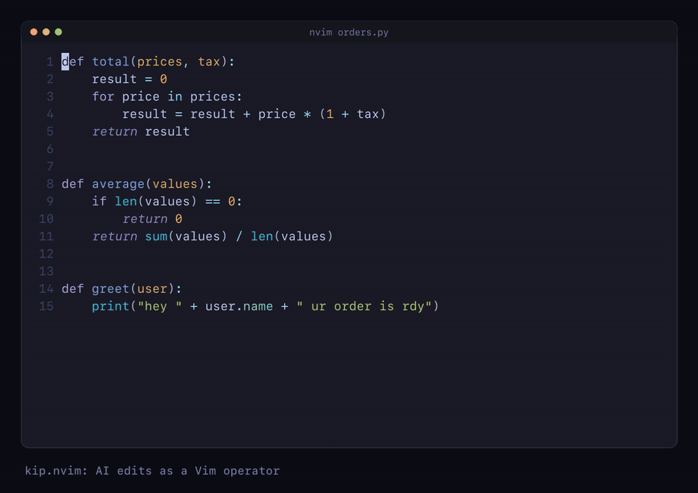
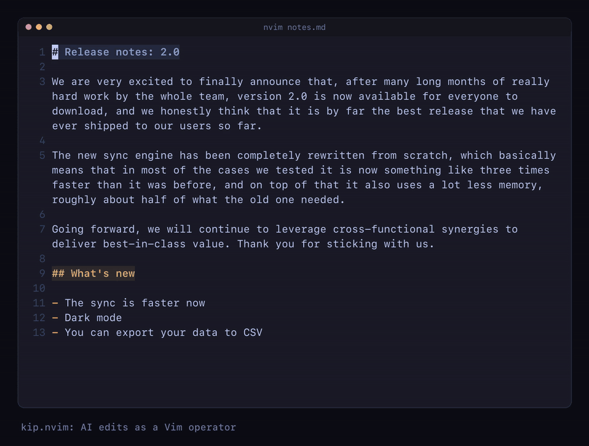

# kip.nvim

> `space` `k` `i` `p` — and the paragraph under your cursor is somebody else's problem.



**kip** is Cursor's Cmd+K for people who never left the terminal: pick some text, say what you want, and it's rewritten in place. No chat panel. No sidebar. No "Certainly! Here's the updated code".

The trick is that kip isn't a command, it's an **operator** — a new verb in Vim's grammar, right next to `d`, `c` and `y`. So it works with every motion and text object you already have in your fingers:

```
<leader>k  ip     "AI-edit inner paragraph"   ← yes, the plugin is named after this
<leader>k  iw     inner word
<leader>k  i(     inside the parens
<leader>k  a"     a quoted string
<leader>k  3j     this line and three below
<leader>k  /foo⏎  everything up to the next "foo"
```

A small window pops up above the selection, you type something like *"add type hints"* or *"make this not embarrassing"*, hit `⏎`, and go back to work. The text swaps in when the model answers.

It isn't only for code. Paragraphs, sentences and list items are text objects too:



## Why you might like it

- **It speaks Vim.** Motions, text objects, counts, visual mode — including the ones from mini.ai and treesitter.
- **`.` repeats the instruction.** Rewrite one function, jump to the next, press `.`. No prompt, same instruction, new target.
- **`u` undoes it.** One edit, one undo step. The model has no say in the matter.
- **It doesn't block you.** Keep editing while the request runs; the target region is tracked, so the result lands in the right place even if the text around it has moved.
- **No API key required.** If you have [Claude Code](https://claude.com/claude-code) installed, kip just uses it.
- **Small.** Three Lua files, no dependencies beyond `curl` or the `claude` CLI.

## Keys

| Keys | What gets edited |
|---|---|
| `<leader>k{motion}` | any motion or text object |
| `<leader>kk` | the current line (`3<leader>kk` for three) |
| `<leader>k` in visual mode | the selection |
| `.` | same instruction, new place |
| `u` | changed your mind |
| `<C-c>` | cancel a request in flight |
| `:[range]Kip [instruction]` | the same, from the command line |
| `:KipCancel` | cancel requests in this buffer |

Inside the prompt window: `⏎` applies, `Esc` (in normal mode), `q` or `<C-c>` closes, `↑`/`↓` walk through your previous instructions. It's a regular buffer, so yes, you can `ciw` your prompt.

## Install

With [lazy.nvim](https://github.com/folke/lazy.nvim):

```lua
{
  "kulichevskiy/kip.nvim",
  event = "VeryLazy",
  opts = {},
}
```

Needs Neovim 0.10 or newer (developed on 0.12), plus either the `claude` CLI or `curl` and an Anthropic API key.

## Where the model comes from

| Backend | How | Needs |
|---|---|---|
| `claude_cli` | runs `claude -p` with your existing login | Claude Code installed |
| `anthropic` | streams from the Anthropic API via `curl` | `ANTHROPIC_API_KEY` |
| `auto` (default) | API if the key is set, CLI otherwise | either |
| a function | `function(request, on_done) ... return cancel_fn end` | your imagination |

The API is the faster of the two, since there's no CLI to start up.

The custom-function backend is the escape hatch for any other model: `request.system` and `request.user` are the prompts, and you call `on_done(text)` or `on_done(nil, err)` when you're done.

## Configuration

Everything below is the default; pass only what you want to change.

```lua
opts = {
  keymaps = { operator = "<leader>k", line = "<leader>kk" }, -- false to skip a mapping
  backend = "auto",
  anthropic = {
    model = "claude-haiku-5-5",
    effort = "low", -- low | medium | high | xhigh | max
    max_tokens = 64000,
    api_key_env = "ANTHROPIC_API_KEY",
    base_url = "https://api.anthropic.com",
    fallbacks = false,
  },
  claude_cli = { cmd = "claude", model = "haiku", effort = "low", extra_args = {} },
  context_lines = 500, -- lines of the file the model sees before and after the selection
  ui = { width = 64, border = "rounded", title = " AI edit " },
  flash_ms = 700,      -- how long the new text stays highlighted (0 = off)
  system_prompt = nil, -- bring your own
}
```

Haiku is the default because inline edits should feel instant. For heavier lifting, set `model = "sonnet"` / `"opus"` for the CLI, or a full model ID for the API.

Highlight groups, if you want to restyle them: `KipSelection`, `KipSpinner`, `KipApplied`.

## Fine print

- The model sees the file around your selection (500 lines each way by default), not your whole project. This is a scalpel, not an agent.
- Blockwise visual selections (`<C-v>`) are treated as one continuous span from the first cell to the last, not as a rectangle.

## Tests

```sh
nvim --headless --clean -u NONE -l tests/run.lua
```

## Demo

The GIFs above are real sessions: `demo/record.py` runs Neovim in a pty and presses the keys, `demo/render.py` turns the recording into a video. The edits are whatever the model answered; only the waiting is cut short. To re-record:

```sh
python3 demo/record.py code /tmp/session.json   # or: prose
uv run --with pyte --with pillow --with fonttools demo/render.py /tmp/session.json demo/kip.mp4
```

## License

[MIT](LICENSE)
